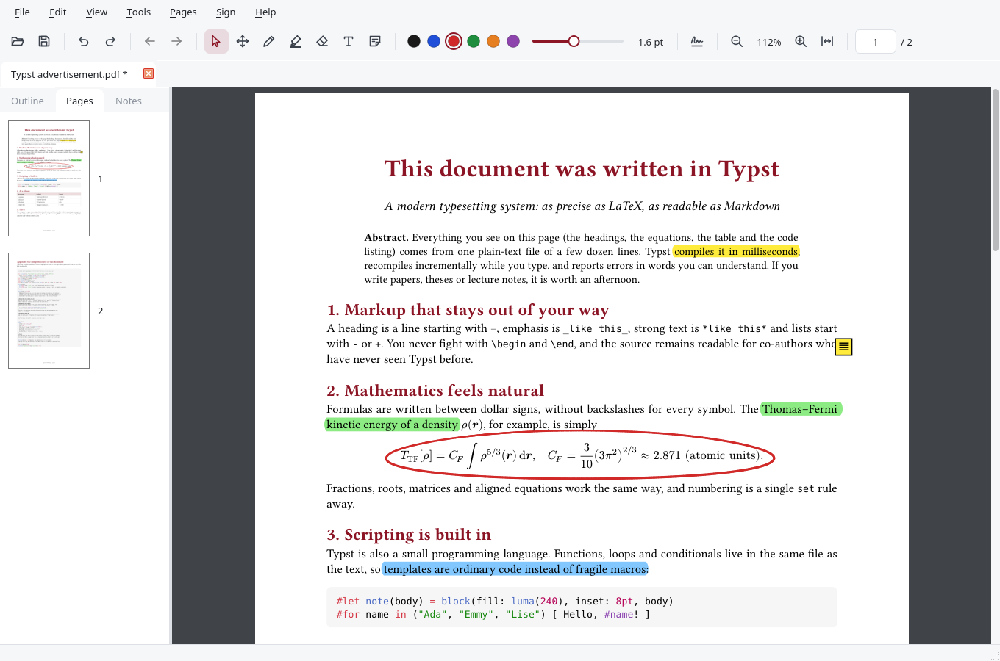

# PDFable

A PDF reader and annotator for Windows pen devices, written in C++17 with Qt 6 Widgets and MuPDF.

*Highlights in several colours, each with a note in the Notes sidebar at the height of its marking, and
freehand pen ink.*

*The Pages sidebar shows a preview of every page, markings included; drag them to reorder pages.*

## What it does

- **Reading**: continuous scrolling, zoom (Ctrl+wheel, pinch, fit width/page), outline sidebar, text search,
  text selection and copy, back/forward after link jumps, printing, password-protected files.
- **Everyday comfort**: reopens the files from the last session at the page and zoom where you left them;
  reloads a file automatically when another program rewrites it (LaTeX); a second start, e.g. double-clicking a
  PDF in Explorer, opens the file as a tab in the running window; page themes Light, Sepia and Dark (dark grey
  paper, light text, colours keep their hue; Ctrl+I toggles); full screen (F11); copy any area of a page as an
  image (Ctrl+Shift+C); adjustable scroll speed (Edit > Preferences); back/forward also for scroll positions
  (Alt+Left/Right, mouse back button).
- **Pen, mouse, finger**: the pen and the mouse each keep their own tool. Tap a toolbar button with the pen to
  set the pen's tool, click it with the mouse for the mouse's tool. When the pen is used, the mouse returns to
  selecting/navigating. A finger only pans and zooms.
- **PDF Creator** (File > Create / merge PDF, or the "PDFable Creator" shortcut, or `PDFable.exe --creator`):
  drop PDFs and images, then join whole files, arrange single pages by hand, or interleave pages (zipper).
- **Tabs and windows**: several documents in tabs; drag a tab out of the bar to get a new window, drop it on
  another window's tab bar to move it there. Ctrl+PgDn and Ctrl+PgUp go to the next and
  previous document.
- **Link previews**: hover an internal link (citation, figure, equation, section) and a pop-up shows the target
  region of the document. Move the pointer into the pop-up to scroll, select, copy or highlight there.
  Click the link to jump, Alt+Left to return.
- **Pen**: pressure-sensitive ink with jitter filtering and curve smoothing. Hold the pen still at the end of a
  stroke and it becomes a straight line, rectangle or ellipse; a snapped line can still be dragged by its end.
  Rectangles and ellipses can be resized the same way: keep the pen down after the snap and drag.
  Six colour presets per tool (right-click or double-click a swatch to change it) and a continuous size slider.
  Highlighter (multiply blend), stroke eraser (also the pen's eraser end and barrel button), palm rejection,
  finger panning. Ink is stored as standard PDF ink annotations, so other readers show it too.
- **Other annotations**: a quick bar next to a text selection highlights, underlines, strikes out or copies
  with one click; text boxes typed directly on the page (double-click to edit, drag a corner to change the
  font size); images. The Select tool
  moves and resizes ink, text boxes and images; Del removes them. Undo/redo for everything.
- **Notes on markings** (like Zotero): select text, pick a colour in the small bar (or press Ctrl+H) and
  type; the note appears in the sidebar's "Notes" tab at the height of the marking, joined to it by a fine
  line. Click a note to edit it (Ctrl+Enter or a click elsewhere saves, Esc cancels); right-click to delete.
  Preferences decide whether the note editor opens right after marking or only when you click a marking.
  Notes are stored as standard PDF annotation comments, so other PDF readers show them too.
- **PDF forms**: fillable fields are tinted blue. Click a text field and type on the page (Tab / Shift+Tab
  jump between fields, Enter or a click elsewhere confirms, Esc cancels); checkboxes and radio buttons toggle
  on click; dropdowns and list boxes open a menu. Works with the Select and Hand tools.
- **Handwritten signatures**: draw once, keep in a library, place and resize on any page (Sign menu).
- **Page editing**: drag thumbnails to reorder; rotate, delete, extract, insert pages from another PDF, insert
  blank pages, merge files, save an optimised (smaller) copy.

Certificate-based signing (PAdES / CAdES with PKCS#12 IDs, timestamps, certification, validation) is implemented
in `src/core/Signer.cpp` but switched off by default. Enable it with `-DPDFABLE_SIGNING=ON` and the vcpkg feature
`signing` (adds OpenSSL).

## Building from source

You get the same program on both systems: Windows produces a portable folder and zip, Ubuntu an
AppImage. Both use Qt 6.8.3 and MuPDF 1.28.6. Pick the guide for your system; you don't need both.

### Windows 10/11 (64-bit)

**1. Install the tools** (each once; accept the defaults unless noted):

| Tool | Download | Notes |
|---|---|---|
| Git for Windows | https://git-scm.com/download/win | |
| Visual Studio Build Tools 2022 or newer | https://visualstudio.microsoft.com/downloads/ (under "Tools for Visual Studio": **Build Tools for Visual Studio**) | In the installer tick the workload **"Desktop development with C++"**. It includes the compiler, CMake and Ninja. |
| Python 3 | https://www.python.org/downloads/ | Tick **"Add python.exe to PATH"** on the first installer page. Only used to download Qt. |

**2. Set up vcpkg** (builds MuPDF). Open a Command Prompt (Start menu, type `cmd`) and run:

    git clone https://github.com/microsoft/vcpkg C:\vcpkg
    C:\vcpkg\bootstrap-vcpkg.bat -disableMetrics

If you put vcpkg somewhere else, set the environment variable `VCPKG_ROOT` to that folder.

**3. Get the PDFable source code**, for example into your Documents folder:

    cd %USERPROFILE%\Documents
    git clone https://github.com/tobirieger/PDFable
    cd PDFable

**4. Build:** double-click `build.bat` in the PDFable folder (or type `build.bat` in the Command
Prompt). A window opens and the progress is written to `build_log.txt`.

- The **first** build takes about 10–20 minutes: it downloads Qt into `deps\Qt` and compiles MuPDF.
  Later builds take 1–2 minutes.
- When the window says `BUILD OK`, the program is in **`dist\PDFable\PDFable.exe`** (the creator is
  `PDFable Creator.exe` next to it), and the same folder zipped is
  `dist\PDFable-<version>-windows-x64.zip`. Copy the folder or the zip anywhere; nothing else needs
  to be installed.
- Close PDFable before building again; the build refuses to overwrite a running program.

**If the build fails,** open `build_log.txt`; the last lines start with `ERROR:` and say what is missing.
The common ones:

| Message | What to do |
|---|---|
| `vswhere.exe not found` or `no Visual Studio 2022+ with the C++ x64 toolset` | Install the Build Tools, or open the Visual Studio Installer, click *Modify* and tick "Desktop development with C++". |
| `cmake not found` / `ninja not found` | Visual Studio Installer → *Modify* → *Individual components* → tick "C++ CMake tools for Windows". |
| `no Python found` | Install Python with "Add python.exe to PATH" ticked, then open a new Command Prompt. |
| Qt download error (`RESULT=22`) | A download mirror timed out. Just run `build.bat` again. |
| `vcpkg not found at C:\vcpkg` | Do step 2, or set `VCPKG_ROOT`. |
| `PDFable is still running` | Close all PDFable windows and build again. |

### Ubuntu (24.04 or newer, on a normal PC or in WSL)

**1. Get the source code** (open a terminal):

    sudo apt install -y git
    git clone https://github.com/tobirieger/PDFable
    cd PDFable

**2. Install everything else** (once; asks for your password, takes about 5–15 minutes):

    ./dev.sh setup

This installs the compiler and libraries with `apt`, downloads Qt 6.8.3 into
`~/.local/share/pdfable-deps` and compiles MuPDF there. Nothing outside your home folder is touched
apart from the `apt` packages.

**3. Build, test and start:**

    ./dev.sh build      # compiles into ~/.cache/pdfable/build-linux
    ./dev.sh test       # automatic self-test, should end with "ALL PASSED"
    ./dev.sh run        # starts PDFable (./dev.sh creator starts the PDF creator)

**4. Make the AppImage** (a single file you can copy to other Linux PCs):

    ./dev.sh appimage   # creates dist/PDFable-<version>-x86_64.AppImage

Logs of every step are in the `logs` folder. If `./dev.sh` says "Permission denied", run it as
`bash dev.sh ...` instead. Other distributions work too if you install the build tools yourself;
`./dev.sh setup` then skips `apt`, and `QT_DIR=/path/to/qt ./dev.sh build` uses an existing Qt 6.

### Both versions from one Windows PC (WSL)

To develop on Windows and build both versions, install Ubuntu in WSL (PowerShell as administrator:
`wsl --install -d Ubuntu-24.04`), follow the Windows guide above, and keep the PDFable folder on the
Windows drive. Then either double-click **`wsl-dev.bat`**, which runs the Ubuntu setup (no password
needed), the Linux build and test, the AppImage and the Windows build in one go, or run
`./dev.sh all` in Ubuntu inside the PDFable folder (it appears as `/mnt/c/Users/<you>/...`). With WSLg,
`./dev.sh run` shows the Linux version as a normal window on the Windows desktop. VS Code with the WSL
extension picks up `CMakePresets.json` (preset "linux"), which uses the same folders as `dev.sh`.

## Packages

- **Windows:** `dist\PDFable-<version>-windows-x64.zip`. Unzip anywhere and start `PDFable.exe`, or
  `PDFable Creator.exe` for the creator. Nothing to install: Qt and the Visual C++ runtime are inside.
  The unpacked folder is also in `dist\PDFable`.
- **Linux:** `dist/PDFable-<version>-x86_64.AppImage`. `chmod +x` it and run it on any distribution
  at least as new as the one it was built on. `PDFable-*.AppImage --creator` opens the creator.

## Status

Automated headless test in `tests/tests.cpp` (`./dev.sh test`). Pen and touch input are tested by hand on
Windows.

Known gaps: text selection is per page; form filling is not
implemented; extracting or merging pages keeps ink and comments but drops links and form fields; saving
resets the undo history.

## Shortcuts

V select, H hand, P pen, M highlighter, E eraser, T text box, Ctrl+F find, Ctrl+H highlight selection,
Ctrl+Shift+H handwritten signature, F4 sidebar, Ctrl+1/2/0 fit page / fit width / 100 %, Alt+Left/Right history.

## Licence

PDFable is free software under the GNU Affero General Public License v3.0 or later (see `LICENSE`).
It is built on MuPDF (AGPL-3.0) and Qt (LGPL-3.0); anyone you give PDFable to is entitled to its source
code, which this repository provides.
